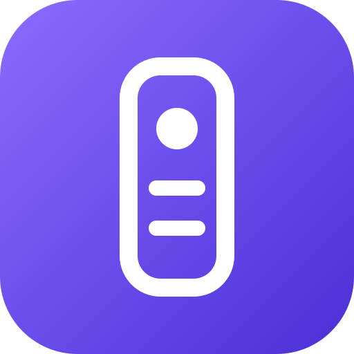

# RemoteTV

An ad-free, open-source TV remote and caster. It is a rebuild of a typical "TV Remote & Screen Mirror" app, with every premium feature free.



**Supported TVs:** Sony BRAVIA (IP control), Android TV / Google TV (Remote v2, the same protocol as Google's app), Roku, LG webOS and Samsung Tizen. **Casting** uses DLNA and DIAL, which most smart TVs support.

How it works: a small Node.js hub runs on any always-on machine on your Wi-Fi (PC, Raspberry Pi, or Termux on an old Android phone). Your phone opens the hub's address and installs it as an app (PWA). The hub speaks the TV protocols, which browsers cannot do directly.

```
Phone (PWA) ──HTTP/WebSocket──► RemoteTV hub ──► TV (Sony REST/IRCC · Android TV v2 TLS · Roku ECP · LG SSAP · Samsung WS · DLNA · DIAL)
```

See [docs/EVIDENCE.md](docs/EVIDENCE.md) for the analysis of the original app and the comparison table.

## Features

- **Remote:** touchpad (swipe, tap = OK, hold = Back) or D-pad, volume and channel rockers with hold-to-repeat, live volume level, mute, home, back, all-apps sheet, input list, media keys, number pad, colour keys, info and guide.
- **Quick access:** your own app shortcut row. Opens Netflix, YouTube, Prime Video, Disney+, Spotify or any app the TV reports.
- **Keyboard:** type into the TV's search box (Sony, LG, Samsung, Roku).
- **Voice:** speak a search; it opens TV search and types the words for you. Needs the HTTPS address.
- **Cast:** push photos, videos and audio from the phone to the TV's built-in player (DLNA). Open YouTube or Shorts links on the TV (DIAL). Play any direct media URL. Pause, resume and stop from the phone.
- **Power:** off and on (Sony REST, Android TV), plus Wake-on-LAN from standby.
- **Settings:** haptics, smooth press, keep screen awake, theater mode, swipe sensitivity, saved TVs. Everything is unlocked.
- **Extras:** auto-discovery (SSDP and mDNS), macros API, desktop keyboard shortcuts, optional hub PIN, offline app shell.

## Quick start

```bash
git clone https://github.com/imuhakim/remotetv.git
```

```bash
cd remotetv && npm install
```

```bash
npm start
```

The hub prints two addresses:

```
Phone (same Wi-Fi): http://192.168.0.x:8080
HTTPS (voice + wake lock): https://192.168.0.x:8443
```

1. Open the address on your phone. Choose **Add to Home screen** to install it.
2. Tap **Tap to connect your TV**, then **Scan network**, and pick your TV.
3. **Android / Google TV:** type the code shown on the TV. **Sony BRAVIA (IP control):** on the TV, go to *Settings › Network › Home network › IP control*. Set *Authentication* to **Normal and Pre-Shared Key** and set a key, then enter that key. **LG / Samsung:** accept the prompt on the TV. **Roku:** no pairing needed.

Tip for Sony Android TVs such as the KD-55X7500F: you can add the same TV twice. Use **Android TV** for live volume and power events, and **Sony BRAVIA** for the keyboard, the HDMI input list and power-on.

### Panduan ringkas (Bahasa Melayu)

1. Pasang [Node.js](https://nodejs.org) 18+ pada PC atau laptop yang guna Wi-Fi sama dengan TV.
2. Jalankan `npm install`, kemudian `npm start`.
3. Di telefon, buka alamat `http://192.168.x.x:8080` yang dipaparkan, kemudian pilih *Add to Home screen*.
4. Tekan **Scan network** dan pilih TV. Untuk Android TV, masukkan kod yang keluar di TV.
5. Untuk suara (mic) dan skrin sentiasa hidup, guna alamat `https://…:8443` dan terima amaran sijil.

## Configuration

| Env var | Default | Purpose |
|---|---|---|
| `PORT` | `8080` | HTTP port |
| `HTTPS_PORT` | `8443` | HTTPS port with a self-signed certificate (`0` disables it) |
| `REMOTETV_PIN` | none | Require a PIN for the API and WebSocket |
| `REMOTETV_DATA` | `./data` | Where paired TVs, certificates and cast files are stored |

Pairing secrets live only in `data/store.json`, which is git-ignored. The API never returns PSKs or certificates.

## API

All endpoints are JSON under `/api`.

| Method | Path | Body |
|---|---|---|
| GET | `/discover` | |
| GET/POST | `/devices` | `{host, type, name, psk?, mac?}` |
| POST | `/devices/:id/connect` | |
| POST | `/devices/:id/pair` | `{code}` |
| POST | `/devices/:id/key` | `{key, mode?: short\|start\|end}` |
| POST | `/devices/:id/text` | `{text}` |
| POST | `/devices/:id/volume` | `{level}` |
| GET | `/devices/:id/apps` | |
| POST | `/devices/:id/launch` | `{id}` (app id or name) |
| GET/POST | `/devices/:id/inputs`, `/input` | `{id}` |
| POST | `/devices/:id/wake` | |
| POST | `/devices/:id/macro` | `{steps: [{key}\|{text}\|{app}, delay?]}` |
| POST | `/devices/:id/cast/upload` | raw file body plus an `x-filename` header |
| POST | `/devices/:id/cast/url` | `{url, mime?}` |
| POST | `/devices/:id/cast/youtube` | `{url}` |
| POST | `/devices/:id/cast/control` | `{action: pause\|resume\|stop\|seek\|volume, value?}` |

Key names: `up down left right ok back home menu apps vol_up vol_down mute ch_up ch_down power power_off input info guide settings search play pause play_pause stop rewind forward prev next 0-9 red green yellow blue`.

Live TV state (power, volume, current app) and pairing prompts are pushed over the WebSocket at `/ws`.

## Tests

```bash
npm test
```

The tests run the hub against a fake Sony BRAVIA. They cover:

- PSK rejection
- the IRCC codes learned from the TV and the built-in fallback codes
- text, volume, the app list and app launch
- DLNA `SetAVTransportURI`/`Play`, status and controls
- YouTube through DIAL
- phone upload streaming and macros.

The Android TV, LG and Samsung drivers follow the libraries and protocols listed in [docs/EVIDENCE.md](docs/EVIDENCE.md). They have not been tested against real sets yet.

## Roadmap

- Native Android wrapper (Capacitor) so the phone talks to the TV without a hub. That needs TCP and TLS sockets, which browsers do not have.
- Screen mirroring from the phone. This needs a native app, using Android `MediaProjection` with Cast or Miracast.
- Text entry over the Android TV Remote v2 IME channel.

## License

MIT
